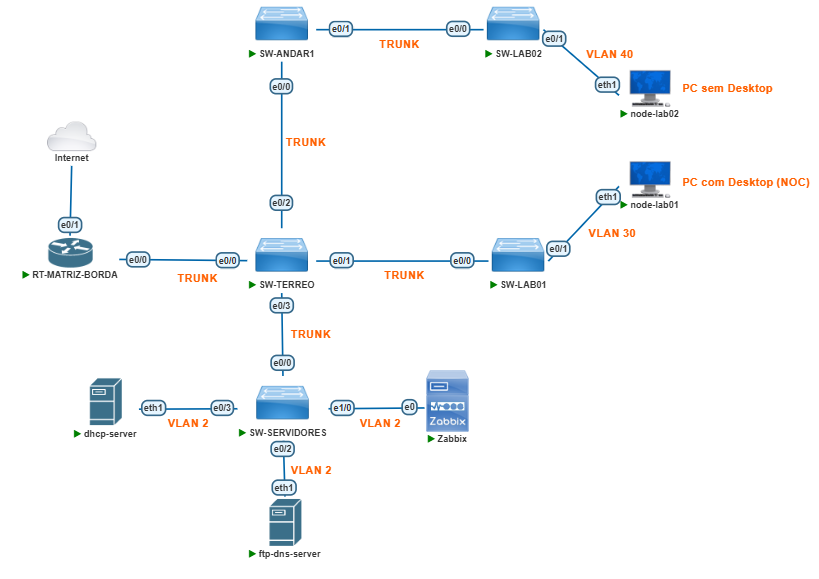

# Faculdade FAFEFIFOR — Projeto Final: Plano de Endereçamento IPv4 e Serviços Essenciais


Repositório do **Projeto Final** — implantação do Plano de Endereçamento IPv4 e dos serviços essenciais (DHCP, DNS, FTP e Zabbix) da recém-fundada **Faculdade FAFEFIFOR**, no laboratório `projeto_final` do **PNETLab**.

---

## Sobre o projeto

O edifício da FAFEFIFOR possui dois pavimentos (térreo e primeiro andar), com 10 salas de aula, 2 laboratórios de informática, 3 salas para professores e 5 salas administrativas. Para habilitar a conectividade com **desempenho e segurança**, a equipe de TI segmentou a rede em **7 VLANs** que isolam o tráfego de servidores, administrativo/professores, salas de aula, laboratórios, roteadores sem fio (WLAN) e gerência de switches.

Este trabalho cobre as duas partes do enunciado:

- **Parte 1 — Planejamento:** cálculo das sub-redes a partir do bloco público `200.47.132.0/22` (um `/26` por VLAN pública) e da tabela de endereçamento estático dos dispositivos.
- **Parte 2 — Implantação:** VLANs e troncos nos switches Cisco, roteamento inter-VLAN (Router-on-a-Stick) com NAT, servidores Linux (DHCP, DNS/FTP) e monitoramento com **Zabbix** (SNMP + Agent).

## Topologia do laboratório



Fachada do edifício da FAFEFIFOR:


**Conexões físicas (todas como trunk 802.1Q):**

| Origem | Porta | Destino | Porta |
| --- | --- | --- | --- |
| RT-MATRIZ-BORDA | e0/0 | SW-TERREO | e0/0 |
| SW-TERREO | e0/1 | SW-LAB1 | e0/0 |
| SW-TERREO | e0/2 | SW-ANDAR1 | e0/0 |
| SW-TERREO | e0/3 | SW-SERVIDORES | e0/0 |
| SW-ANDAR1 | e0/1 | SW-LAB2 | e0/0 |
| RT-MATRIZ-BORDA | e0/1 | Nuvem/Internet (PNETLab) | — (DHCP/NAT) |

**Dispositivos clientes:**

| Nó | Conexão | VLAN | SO | Papel |
| --- | --- | --- | --- | --- |
| node-lab01 | SW-LAB1 e0/1 | 30 (LAB1) | Ubuntu com Desktop | NOC — acesso ao Zabbix via browser |
| node-lab02 | SW-LAB2 e0/2 | 40 (LAB2) | Ubuntu sem Desktop | Testes de conectividade |

## Stack utilizada

| Camada | Tecnologia |
| --- | --- |
| Virtualização | PNETLab sobre VirtualBox (imagem `.vdi`) |
| Switches (5x 24p GE) | Cisco IOSvL2 |
| Roteador (4p GE) | Cisco IOSv — Router-on-a-Stick + NAT |
| Servidores | Ubuntu Server: isc-dhcp-server, BIND9, vsftpd, Zabbix |
| Monitoramento | Zabbix Server + Zabbix Agent + SNMP (Ciscos) |

## Plano de endereçamento

A faculdade adquiriu o bloco **`200.47.132.0/22`** (faixa `200.47.132.0` a `200.47.135.255`, máscara `255.255.252.0`). As VLANs públicas (2, 10, 20, 30 e 40) recebem um `/26` cada, conforme a distribuição definida na imagem de endereçamento. A **VLAN 2 (Servidores) recebe o primeiro bloco**. As VLANs WLAN (50) e GERENCIA (99) usam faixas privadas: `172.16.0.0/16` (via DHCP) e `192.168.100.0/24` (estático), respectivamente.

### Tabela 1 — VLANs

| ID | Nome | Descrição | Dispositivos previstos |
| --- | --- | --- | --- |
| 2 | SERVIDORES | Servidores da Rede | 10 |
| 10 | ADMPROF | Administrativo e Professores | 62 |
| 20 | SALAS | Salas de aula | 60 |
| 30 | LAB1 | Laboratório 1 | 30 |
| 40 | LAB2 | Laboratório 2 | 30 |
| 50 | WLAN | Roteadores sem fio | 12 |
| 99 | GERENCIA | Gerência de switches | 6 |

### Tabela 3 — Sub-redes IPv4 por VLAN

| ID VLAN | Sub-rede (IPv4) | Hosts (IPv4) | Broadcast (IPv4) |
| --- | --- | --- | --- |
| 2 | `200.47.132.0/26` | `200.47.132.1` – `200.47.132.62` | `200.47.132.63` |
| 10 | `200.47.134.0/26` | `200.47.134.1` – `200.47.134.62` | `200.47.134.63` |
| 20 | `200.47.133.0/26` | `200.47.133.1` – `200.47.133.62` | `200.47.133.63` |
| 30 | `200.47.135.0/26` | `200.47.135.1` – `200.47.135.62` | `200.47.135.63` |
| 40 | `200.47.132.128/26` | `200.47.132.129` – `200.47.132.190` | `200.47.132.191` |
| 50 | `172.16.0.0/16` | `172.16.0.1` – `172.16.255.254` | `172.16.255.255` |
| 99 | `192.168.100.0/24` | `192.168.100.1` – `192.168.100.254` | `192.168.100.255` |

> Nota: cada `/26` oferece 62 hosts úteis. Na VLAN 10 (ADMPROF) foram previstos 62 dispositivos e o último IP fica reservado ao gateway, restam 61 endereços para alocação dinâmica — capacidade apertada por desenho do enunciado.

### Tabela 4 — Endereçamento estático dos dispositivos

| Dispositivo | Interface | Endereço IP | Máscara | Gateway |
| --- | --- | --- | --- | --- |
| RT-MATRIZ-BORDA | e0/0.2 (VLAN 2) | `200.47.132.62` | `255.255.255.192` | — |
| RT-MATRIZ-BORDA | e0/0.10 (VLAN 10) | `200.47.134.62` | `255.255.255.192` | — |
| RT-MATRIZ-BORDA | e0/0.20 (VLAN 20) | `200.47.133.62` | `255.255.255.192` | — |
| RT-MATRIZ-BORDA | e0/0.30 (VLAN 30) | `200.47.135.62` | `255.255.255.192` | — |
| RT-MATRIZ-BORDA | e0/0.40 (VLAN 40) | `200.47.132.190` | `255.255.255.192` | — |
| RT-MATRIZ-BORDA | e0/0.50 (VLAN 50) | `172.16.255.254` | `255.255.0.0` | — |
| RT-MATRIZ-BORDA | e0/0.99 (VLAN 99) | `192.168.100.254` | `255.255.255.0` | — |
| RT-MATRIZ-BORDA | e0/1 (externa) | via DHCP | — | NAT da nuvem PNETLab |
| SW-TERREO | VLAN 99 | `192.168.100.1` | `255.255.255.0` | `192.168.100.254` |
| SW-ANDAR1 | VLAN 99 | `192.168.100.2` | `255.255.255.0` | `192.168.100.254` |
| SW-LAB1 | VLAN 99 | `192.168.100.3` | `255.255.255.0` | `192.168.100.254` |
| SW-LAB2 | VLAN 99 | `192.168.100.4` | `255.255.255.0` | `192.168.100.254` |
| SW-SERVIDORES | VLAN 99 | `192.168.100.5` | `255.255.255.0` | `192.168.100.254` |
| DHCP Server | eth1 (VLAN 2) | `200.47.132.1` | `255.255.255.192` | `200.47.132.62` |
| DNS/FTP Server | eth1 (VLAN 2) | `200.47.132.2` | `255.255.255.192` | `200.47.132.62` |
| Zabbix Server | eth1 (VLAN 2) | `200.47.132.3` | `255.255.255.192` | `200.47.132.62` |

Regra do enunciado: o roteador usa o **último IP** de cada VLAN; os switches recebem do primeiro ao quinto IP da VLAN 99; e os servidores usam os **primeiros IPs** da VLAN 2.

### Pools DHCP sugeridos (isc-dhcp-server)

| VLAN | Sub-rede | Range do pool | Gateway (option routers) |
| --- | --- | --- | --- |
| 2 | 200.47.132.0/26 | 200.47.132.10 – 200.47.132.60 | 200.47.132.62 |
| 10 | 200.47.134.0/26 | 200.47.134.1 – 200.47.134.61 | 200.47.134.62 |
| 20 | 200.47.133.0/26 | 200.47.133.1 – 200.47.133.61 | 200.47.133.62 |
| 30 | 200.47.135.0/26 | 200.47.135.1 – 200.47.135.61 | 200.47.135.62 |
| 40 | 200.47.132.128/26 | 200.47.132.129 – 200.47.132.189 | 200.47.132.190 |
| 50 | 172.16.0.0/16 | 172.16.100.10 – 172.16.100.200 | 172.16.255.254 |

O bloco da **VLAN 2 é obrigatório** mesmo sem clientes: o `isc-dhcp-server` só inicializa com pelo menos uma sub-rede correspondente à interface que ele escuta (eth1). O DNS entregue aos clientes é `200.47.132.2` (e `8.8.8.8` como apoio).

## Distribuição de portas nos switches

| Switch | Portas de acesso | Portas trunk |
| --- | --- | --- |
| SW-TERREO | e1/0–e2/2 (VLAN 10), e2/3–e4/1 (VLAN 20), e4/2–e5/2 (VLAN 50), e5/3 (VLAN 99) | e0/0 (RT), e0/1 (SW-LAB1), e0/2 (SW-ANDAR1), e0/3 (SW-SERVIDORES) |
| SW-ANDAR1 | e0/2–e1/0 (VLAN 10), e1/1–e2/3 (VLAN 20), e3/0–e4/3 (VLAN 50), e5/3 (VLAN 99) | e0/0 (SW-TERREO), e0/1 (SW-LAB2) |
| SW-LAB1 | e0/1–e5/2 (VLAN 30), e5/3 (VLAN 99) | e0/0 (SW-TERREO) |
| SW-LAB2 | e0/1–e5/2 (VLAN 40), e5/3 (VLAN 99) | e0/0 (SW-ANDAR1) |
| SW-SERVIDORES | e0/2 (DNS/FTP), e0/3 (DHCP), e1/0 (Zabbix), e1/1–e5/2 (VLAN 2), e5/3 (VLAN 99) | e0/0 (SW-TERREO), e0/1 (reserva) |

A última porta de cada switch (e5/3) é sempre **access na VLAN 99 (Gerência)** — por ela somente dispositivos da VLAN 99 acessam os switches.

## Serviços essenciais

### DHCP (isc-dhcp-server, VLAN 2)

Como o servidor DHCP está centralizado na VLAN 2 e atende às VLANs 10, 20, 30, 40 e 50, o **RT-MATRIZ-BORDA** atua como *DHCP Relay* (`ip helper-address 200.47.132.1`) em cada subinterface. O servidor identifica a origem pelo campo GIADDR e entrega endereços do pool correto. Exemplo de subinterface (com os ajustes de MTU obrigatórios do enunciado):

```
interface GigabitEthernet0/0.10
 encapsulation dot1Q 10
 ip address 200.47.134.62 255.255.255.192
 ip mtu 1400
 ip tcp adjust-mss 1360
 ip helper-address 200.47.132.1
```

A interface externa do roteador obtém IP dinâmico da nuvem PNETLab: `interface GigabitEthernet0/1` + `ip address dhcp`.

### DNS (BIND9, domínio fgv.local)

O DNS/FTP Server (`200.47.132.2`) é o servidor autoritativo primário de `fgv.local`, com forwarder `8.8.8.8` e recursão restrita às redes internas. Principais registros:

| Tipo | Nome | Destino |
| --- | --- | --- |
| A | dns.fgv.local / ftp.fgv.local | 200.47.132.2 |
| A | zabbix.fgv.local | 200.47.132.3 |
| A | dhcp.fgv.local | 200.47.132.1 |
| A | rt-matriz-borda.fgv.local | 200.47.132.62 (gateway da VLAN 2) |
| A | sw-terreo / sw-andar1 / sw-lab1 / sw-lab2 / sw-servidores .fgv.local | 192.168.100.1 – .5 |
| CNAME | www.fgv.local | ftp.fgv.local |
| MX | fgv.local | mail.fgv.local |
| PTR | zona reversa de 200.47.132.0/26 (RFC 2317) | dns, ftp, zabbix, rt-matriz-borda |

### FTP (vsftpd, VLAN 2)

Acesso anônimo **desabilitado** e login de usuário local habilitado com leitura/escrita, para transferências autenticadas a partir dos clientes (`ftp 200.47.132.2`).

### Monitoramento (Zabbix)

O Zabbix Server (`200.47.132.3`) monitora toda a infraestrutura; o frontend é acessado pelo **node-lab01** (NOC — único PC com Desktop; o checklist menciona "node-admprof", possivelmente uma revisão do enunciado).

| Host monitorado | Interface no Zabbix | Método |
| --- | --- | --- |
| RT-MATRIZ-BORDA | 192.168.100.254 | SNMP |
| SW-TERREO / SW-ANDAR1 / SW-LAB1 / SW-LAB2 / SW-SERVIDORES | 192.168.100.1 – .5 | SNMP |
| Zabbix Server | 200.47.132.3 | Zabbix Agent |
| DNS/FTP Server | 200.47.132.2 | Zabbix Agent |
| DHCP Server | 200.47.132.1 | Zabbix Agent |

Critério de sucesso: ícones de disponibilidade **SNMP (verde)** nos Ciscos, **ZBX (verde)** nos servidores e métricas chegando em *Monitoring > Latest data*. A *community* SNMP não é definida no enunciado — escolha uma (ex.: `fgv-ro`) e configure-a nos Ciscos (`snmp-server community fgv-ro RO`) e nos hosts do Zabbix.

## Credenciais do laboratório

> Aviso: credenciais exclusivamente didáticas, de uso em ambiente de laboratório.

| Dispositivo / Serviço | Usuário | Senha | Observação |
| --- | --- | --- | --- |
| Switches / Roteador (SSH) | admin | cisco123 | Privilégio 15 |
| Switches / Roteador (enable) | — | fgv_secure | enable secret |
| FTP Server (vsftpd) | ftuser | ti_ftp24 | Leitura/escrita |
| Frontend do Zabbix | Admin | zabbix | Padrão de instalação nova; trocar no 1º acesso |
| VM PNETLab | root | pnet | Padrão da distribuição (salvo alteração) |

## Como executar o lab (importação do .vdi)

### Requisitos

- VirtualBox 7.x (ou VMware Workstation Player) com **VT-x/AMD-V habilitado** na BIOS;
- **8 GB de RAM** dedicados à VM (mínimo 4 GB), 2–4 vCPUs;
- ~20 GB de disco livre para a imagem e os discos dos nós;
- Navegador no host para acessar a interface web do PNETLab.

### Passo a passo

1. **Obtenha a imagem**: clone este repositório (ou baixe o `.vdi` do link indicado na seção [Estrutura do repositório](#estrutura-do-repositório)) e salve em uma pasta local, ex.: `~/VirtualBox VMs/`.
2. **Crie a VM** no VirtualBox: `Novo` → nome `PNETLab-FAFEFIFOR`, Tipo **Linux**, Versão **Ubuntu (64-bit)**.
3. **Memória e CPU**: 8192 MB de RAM (ou o mínimo disponível) e 2+ processadores.
4. **Disco**: em "Disco rígido", escolha **"Usar um disco rígido virtual existente"** e selecione o arquivo `.vdi` do lab.
5. **Ajustes finos**: Display → memória de vídeo 128 MB; Rede → Adaptador 1 em modo **NAT** (ou Bridge, conforme seu ambiente) — é por ele que o lab acessa a Internet/nuvem.
6. **Inicie a VM** e aguarde o boot do PNETLab; no console, faça login (`root`).
7. **Descubra o IP** da VM (`ip a`) e acesse `http://<IP-da-VM>` no navegador do host; entre com sua conta do PNETLab.
8. **Abra o lab `projeto_final`** (já importado na imagem), confira os nós da topologia e ligue todos os dispositivos.
9. **Implante**: siga a Parte 2 do enunciado — SSH e VLANs nos Ciscos, Router-on-a-Stick (não esqueça de `ip mtu 1400` e `ip tcp adjust-mss 1360` nas subinterfaces), servidores Linux e Zabbix.

### Fluxo de implantação (resumo)

1. SSH em todos os switches e no roteador (usuário `admin`, privilégio 15).
2. Criação das 7 VLANs e associação das portas (tabela acima).
3. IPs de gerência (VLAN 99) nos switches + subinterfaces do roteador (ROAS).
4. `ip address dhcp` na e0/1 do roteador (NAT da nuvem).
5. IPs estáticos nos 3 servidores (Tabela 4) com DNS `8.8.8.8` para instalação de pacotes.
6. isc-dhcp-server (6 blocos de sub-rede) + relay no roteador + DHCP nos PCs.
7. vsftpd (sem anônimo, usuário local) e BIND9 (fgv.local + zona reversa).
8. Zabbix: hosts SNMP (Ciscos) e Agent (Linux), validação por ícones e *Latest data*.

## Testes de verificação

| Teste | Resultado esperado |
| --- | --- |
| VLANs e troncos | `show vlan brief` e `show interfaces trunk` corretos em cada switch |
| Roteamento inter-VLAN | 7 subinterfaces UP (`show ip interface brief`) e rotas conectadas (`show ip route`) |
| NAT / Internet | node-lab02 (DHCP, VLAN 40) pinga `google.com` |
| DHCP | node-lab01 e node-lab02 recebem IP/gateway/DNS do pool das VLANs 30 e 40 |
| DNS | `nslookup ftp.fgv.local` resolve a partir de um cliente |
| FTP | Login `ftuser` com `ls`/`put`/`get` funcionando |
| Intra/Inter-VLAN | pings entre hosts da mesma VLAN e de VLANs distintas |
| Gerência (VLAN 99) | PC1/PC2-GERENCIA com IP manual falam entre si e com os switches (só VLAN 99 acessa switches) |
| Zabbix | Ícones SNMP/ZBX verdes e métricas em *Latest data* |

## Mapeamento com o checklist de avaliação

| Critério | Pontos | Onde verificar |
| --- | --- | --- |
| 1.1 Cálculo de sub-redes | 0.5 | Tabela 3 deste README |
| 1.2 IPs estáticos | 0.5 | Tabela 4 deste README |
| 2.1 VLANs | 0.5 | `show vlan brief` em cada switch |
| 2.2 SSH e gerência | 0.5 | `ssh admin@192.168.100.x`; e5/3 = access VLAN 99 |
| 2.3 Trunking e access | 0.5 | `show interfaces trunk` |
| 2.4 ROAS (7 subinterfaces) | 1.0 | `show ip interface brief` |
| 2.5 DHCP na externa | 0.5 | `show running-config` (e0/1) |
| 2.6 Teste inter-VLAN | 0.5 | node-lab02 → ping 192.168.100.x |
| 2.7 NAT / Internet | 0.5 | node-lab02 → ping google.com |
| 2.8 DHCP | 1.5 | `ip address show` / `ip route show` nos PCs |
| 2.9 DNS | 1.0 | `nslookup ftp.fgv.local` |
| 2.10 FTP | 1.0 | `ftp 200.47.132.2` com ftuser |
| 2.11 SNMP (Ciscos) | 0.5 | Ícones verdes no frontend |
| 2.12 Agent (Linux) | 0.5 | Ícones ZBX verdes |
| 2.13 Coleta de dados | 0.5 | Monitoring > Latest data |

## Estrutura do repositório

```
.
├── README.md
├── img/
│   ├── topologia.png
│   └── fachada.png
├── docs/
│   ├── descricao-projeto-pirc.pdf
│   └── checklist-projeto-final.pdf
└── lab/
    └── pnetlab-fafefifor.vdi   # imagem do lab (não versionada via git normal)
```

**Sobre o `.vdi`:** imagens de VM geralmente superam o limite de 100 MB do Git. Prefira **Git LFS** (`git lfs install && git lfs track "*.vdi"`) ou publique o arquivo em um **Release do GitHub**, Google Drive ou similar e referencie o link aqui / no campo acima.

## Referências

- Enunciado do projeto (`docs/descricao-projeto-pirc.pdf`)
- Checklist de avaliação (`docs/checklist-projeto-final.pdf`)
- Calculadora de sub-redes: <https://ipv6.br/paginas/subnet/>
- Documentação do PNETLab: <https://pnetlab.com/pages/documentation>
- Documentação do Zabbix: <https://www.zabbix.com/documentation/current/pt/manual>
- Guia de servidor DHCP (Ubuntu): <https://documentation.ubuntu.com/server/how-to/networking/install-dhcp-server/>
- BIND9 (Ubuntu Server Guide): <https://documentation.ubuntu.com/server/how-to/networking/name-resolution/>
